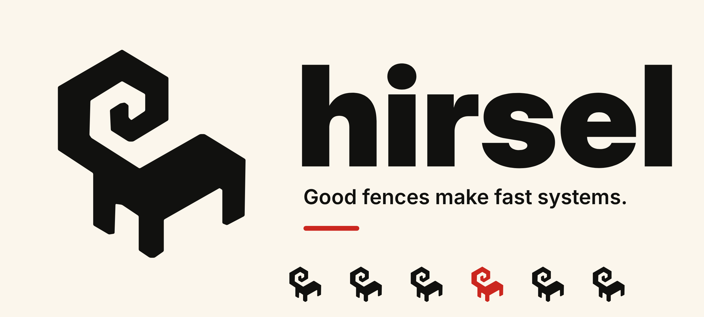

<p align="center">
  <a href="https://hirsel.ai"></a>
</p>

<p align="center">
  A language for agents 🐑<br>
  A native systems language with explicit authority, logical byte budgets, and recorded replay.<br>
  Unbounded generation, bounded execution.
</p>

<p align="center">
  <a href="https://hirsel.ai"><b>hirsel.ai</b></a>
  &nbsp;·&nbsp;
  <a href="docs/PRIMER.md">Primer</a>
  &nbsp;·&nbsp;
  <a href="docs/COOKBOOK.md">Cookbook</a>
  &nbsp;·&nbsp;
  <a href="docs/spec/index.md">Spec</a>
  &nbsp;·&nbsp;
  <a href="core/std/API-INDEX.md">Std API</a>
  &nbsp;·&nbsp;
  <a href="docs/building.md">Building</a>
  &nbsp;·&nbsp;
  <a href="https://hirsel.ai/llms.txt">llms.txt</a>
</p>

<p align="center">
  <sub>Status: <b>v0.1.0-pre</b> · Linux x86_64 (glibc 2.28+) · Apple Silicon macOS in progress</sub>
</p>

<picture>
  <source media="(prefers-color-scheme: dark)" srcset="docs/assets/readme-hero-dark.svg">
  <source media="(prefers-color-scheme: light)" srcset="docs/assets/readme-hero-light.svg">
  
</picture>

<details>
<summary>View / copy source (<code>main.hirsel</code>)</summary>

```hirsel
pub fn main(out: Stdout) -> Result[(), WriteError] waits {
  let mut names: List[String] = list.new()
  list.push(mut names, "ada")
  list.push(mut names, "grace")
  let mut line = string.new()
  for n in names {
    string.push(mut line, n)
    string.push(mut line, " ")
  }
  string.push_u64(mut line, list.len(names))
  string.push(mut line, "\n")
  stdout.write(out, line)
}
```

</details>

Every outside effect enters as a parameter (`Stdout`, `Dir`, `Clock`, `Net`, `Tasks`),
every allocation is charged against an explicit byte limit, and every function checks
locally against the signatures it names. No imports, no methods, no garbage collector, no
lifetime annotations.

## Install

```sh
curl -fsSL https://hirsel.ai/install.sh | sh
```

Requires **Linux x86_64** with **glibc 2.28+** (Apple Silicon macOS support is in
progress). Re-run the installer to upgrade, or set `HIRSEL_VERSION` to pin a release.

Start a project with the installed binary:

```sh
hirsel new app && cd app
hirsel check
hirsel test
hirsel run --grant Stdout
```

See [docs/PRIMER.md](docs/PRIMER.md) for the language in one page,
[docs/COOKBOOK.md](docs/COOKBOOK.md) for tested recipes, and
[docs/building.md](docs/building.md) for CLI options, capabilities, recording/replay, and
building from source.

## For Coding Agents

> **Authority rule:** Always run `hirsel primer` from your installed binary as the exact
> authority for your installed version.

Hirsel's CLI is designed as a self-contained feedback loop for agents:

- `hirsel primer` — prints the exact language primer matching your installed compiler.
- `hirsel explain RULE` (`--list`, `--json`) — prints the normative rule and refused example for any diagnostic ID (e.g., `OWN-7`, `CAP-1`).
- `hirsel inspect --core --interface` / `hirsel inspect --std --interface` — lists every public core and `std` declaration with exact parameter modes (`mut`, `take`).
- `hirsel check --json` — machine-readable diagnostics with rule IDs, spans, and causal sites.
- [hirsel.ai/llms.txt](https://hirsel.ai/llms.txt) — concise agent index.
- [hirsel.ai/llms-full.txt](https://hirsel.ai/llms-full.txt) — single-file agent bundle (intro, primer, cookbook, std API index, and skill).
- [skills/hirsel/SKILL.md](skills/hirsel/SKILL.md) — ready-to-use agent skill for editing, checking, and fixing Hirsel packages.

## Toolchain packages

Three packages ship with the Hirsel toolchain and bind by major version in `hirsel.toml`:

```text
[dependencies]
std = { major = 1 }
store = { major = 1 }
runner = { major = 1 }
```

- [std](core/std/API-INDEX.md) — standard library: files, directories, HTTP server/client, router, JSON, codecs, simulation (`std.sim`), property testing (`std.prop`), and crypto.
- [store](core/programs/store/) — typed tables, secondary indexes, durable transactions, snapshots, and replay.
- [runner](core/programs/runner/) — durable calls, typed subscriptions, TypeScript SDK generation ([sdk/client/README.md](sdk/client/README.md)), and place hosting.

## Libraries and applications

First-party packages in this repository (bind locally with `path = "..."` in `[dependencies]`):

- [postgres](core/programs/postgres/) — PostgreSQL client with TLS and streaming query results.
- [sqlite](core/programs/sqlite/) — SQLite bindings with explicit capabilities.
- [mcp](core/programs/mcp/) — Model Context Protocol client and server over Streamable HTTP.
- [search](core/programs/search/) — BM25 full-text search over `store` snapshots.
- [harness](core/programs/harness/) — durable agent sessions, tools, approvals, and model calls.
- [notes](core/programs/notes/) — offline notes agent with tools and an approval step.
- [checkbox](core/programs/checkbox/) — shared board of one million checkboxes.
- [platform](core/programs/platform/) — deployed place management, cutovers, and recovery.
- [tz](core/programs/tz/) — IANA time zones and instant/local-time conversion.
- [xml](core/programs/xml/) — streaming and tree XML parser and UTF-8 serializer.
- [stun_ice](core/programs/stun_ice/) — STUN message encoding and ICE connectivity checks.
- [image_core](core/programs/image_core/), [image_jpeg](core/programs/image_jpeg/), [image_webp](core/programs/image_webp/) — image probing, transforms, PNG, QOI, GIF, AVIF, JPEG, and WebP codecs.
- [av1](core/programs/av1/), [h264](core/programs/h264/), [opus](core/programs/opus/), [media_bits](core/programs/media_bits/), [media_container](core/programs/media_container/), [video_packager](core/programs/video_packager/), [video_yuv](core/programs/video_yuv/) — audio/video codecs, MP4/WebM/Ogg containers, YUV conversion, and CMAF/HLS/DASH packaging.

Internal verification harnesses and benchmarks (`m1`, `m2b`, `ffi_laws`, `store-crash`,
`harness_dev_serve`, `harness_ts_gateway`, `observe`, `wire`, `omap`, `sha256`) also live
under [core/programs/](core/programs/) for compiler and runtime testing.

## Runnable examples

Standalone recipes that work in any fresh project (`hirsel new app`) are in
[docs/COOKBOOK.md](docs/COOKBOOK.md).

Repository examples (run from a checkout of this repo):

- [Subscription cache](sdk/client/tests/subscription-cache.ts) reads a `store` row from a `runner` subscription, observes cache changes, and applies an optimistic edit ([run the SDK check](sdk/client/README.md#run-the-subscription-example)).
- [PostgreSQL](core/programs/postgres/example.hirsel) reads a typed column and drains the cursor before reusing the connection.
- [SQLite](core/programs/sqlite/example.hirsel) binds a customer ID and reads the total from an in-memory database.
- [MCP](core/programs/mcp/example.hirsel) decodes a tool-list reply and reads the tool name.
- [Search](core/programs/search/example.hirsel) indexes two recipes in `store` and queries a snapshot for the published match.
- [JPEG](core/programs/image_jpeg/vectors/example.hirsel), [WebP](core/programs/image_webp/vectors/example.hirsel), [HLS](core/programs/video_packager/example.hirsel), and [Opus](core/programs/opus/vectors/example.hirsel) media codec and packaging examples.

Run the package examples from the repository root with the `hirsel` binary:

```sh
hirsel test core/programs/postgres --filter select_answer
hirsel test core/programs/sqlite --filter sum_orders --grant Foreign=sqlite@1/sqlite/Sqlite
hirsel test core/programs/mcp --filter read_tool_catalog
hirsel test core/programs/search --filter find_document
hirsel test core/programs/video_packager --filter hls_cmaf
```

The codec examples run with the [JPEG](core/programs/image_jpeg/test-vectors.sh),
[WebP](core/programs/image_webp/test-vectors.sh), and
[Opus](core/programs/opus/test-vectors.sh) vector scripts. Each script lists the
reference inputs it needs.

## License

[MIT](LICENSE) © 2026 Sam Galanakis
