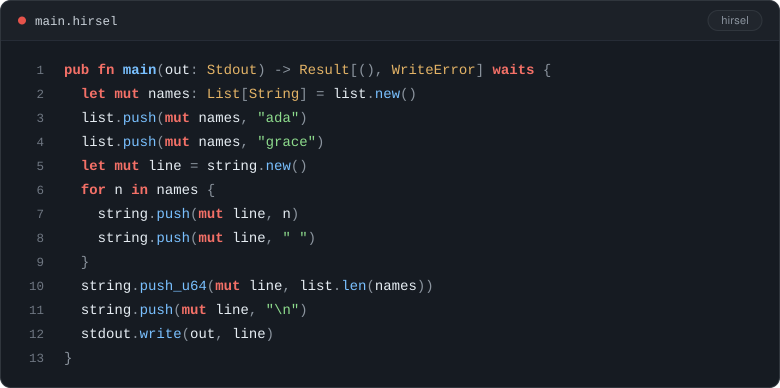

<p align="center">
  <a href="https://hirsel.ai"></a>
</p>

<p align="center">
  A language for agents 🐑<br>
  A native systems language with explicit authority, logical byte budgets, and recorded replay.<br>
  Unbounded generation, bounded execution.
</p>

<p align="center">
  <a href="https://hirsel.ai"><b>hirsel.ai</b></a>
  &nbsp;·&nbsp;
  <a href="docs/PRIMER.md">Primer</a>
  &nbsp;·&nbsp;
  <a href="docs/COOKBOOK.md">Cookbook</a>
  &nbsp;·&nbsp;
  <a href="docs/spec/index.md">Spec</a>
  &nbsp;·&nbsp;
  <a href="core/std/API-INDEX.md">Std API</a>
  &nbsp;·&nbsp;
  <a href="docs/building.md">Building</a>
  &nbsp;·&nbsp;
  <a href="https://hirsel.ai/llms.txt">llms.txt</a>
</p>

<p align="center">
  <sub>Pre-release · Install on Linux x86_64 or macOS arm64 (Apple Silicon)</sub>
</p>

<picture>
  <source media="(prefers-color-scheme: dark)" srcset="docs/assets/readme-hero-dark.svg">
  <source media="(prefers-color-scheme: light)" srcset="docs/assets/readme-hero-light.svg">
  
</picture>

<details>
<summary>View / copy source (<code>main.hirsel</code>)</summary>

```hirsel
pub fn main(out: Stdout) -> Result[(), WriteError] waits {
  let mut names: List[String] = list.new()
  list.push(mut names, "ada")
  list.push(mut names, "grace")
  let mut line = string.new()
  for n in names {
    string.push(mut line, n)
    string.push(mut line, " ")
  }
  string.push_u64(mut line, list.len(names))
  string.push(mut line, "\n")
  stdout.write(out, line)
}
```

</details>

Host access requires explicit capabilities such as `Stdout`, `Dir`, `Clock`, `Net`, and
`Tasks`. Logical byte budgets limit charged program allocations. The compiler checks
function bodies against the signatures they use. No imports, no methods, no garbage
collector, no lifetime annotations. Hirsel enforces capabilities through the compiler and
runtime rather than an OS kernel sandbox: uncontained in-process `Foreign` C code runs
outside the checker and must be trusted or sandboxed by the operator, while contained
`Foreign` code runs isolated.

## Install

```sh
curl -fsSL https://hirsel.ai/install.sh | sh
```

The installer runs on **Linux x86_64** (glibc 2.28+) and **macOS arm64** (Apple Silicon,
macOS 26+). Linux aarch64 is a build target. Re-run the installer to upgrade, or set
`HIRSEL_VERSION` to pin a release. Use the shell installer for the ad-hoc signed macOS
bundle. If you download the tarball in a browser, run
`xattr -dr com.apple.quarantine <dir>` after unpacking.

Start a project with the installed binary:

```sh
hirsel new app && cd app
hirsel check
hirsel test
hirsel run
```

See [docs/PRIMER.md](docs/PRIMER.md) for the language in one page,
[docs/COOKBOOK.md](docs/COOKBOOK.md) for tested recipes, and
[docs/building.md](docs/building.md) for CLI options, capabilities, recording/replay, and
installed-toolchain details.

## For Coding Agents

> **Authority rule:** Always run `hirsel explain primer` from your installed binary as the exact
> authority for your installed version.

Hirsel's CLI is a self-contained feedback loop for agents:

- `hirsel explain primer` — prints the exact language primer matching your installed compiler.
- `hirsel explain RULE` (`--list`, `--json`) — prints a rule such as `OWN-7` and its examples when available.
- `hirsel inspect --core --interface` / `hirsel inspect --std --interface` — lists every public `core` and `std` declaration with exact parameter modes (`mut`, `take`).
- `hirsel check --json` — machine-readable diagnostics with rule IDs, spans, and causal sites.
- `hirsel fmt --check .` / `hirsel fmt .` — canonical zero-config formatting.
- `hirsel audit --json` — reports the resolved dependencies and their [authority](docs/spec/packages.md#11-dependency-authority).
- [hirsel.ai/llms.txt](https://hirsel.ai/llms.txt) — concise agent index.
- [hirsel.ai/llms-full.txt](https://hirsel.ai/llms-full.txt) — single-file agent bundle (intro, primer, cookbook, std API index, and skill).
- [skills/hirsel/SKILL.md](skills/hirsel/SKILL.md) — ready-to-use agent skill for editing, checking, and fixing Hirsel packages.

## Core and toolchain packages

The Hirsel toolchain ships `std` and the [package archives](core/programs/toolchain-packages.hcfg)
in `core-packages/`. Bind them by major version in `hirsel.hcfg`:

```hcfg
dependencies: [
    ("std", Toolchain(package: "std", major: 1, authority: [])),
    ("store", Toolchain(package: "store", major: 1, authority: [])),
    ("runner", Toolchain(package: "runner", major: 1, authority: [])),
],
```

### Tier 1: verified core

Store, runner, platform, search, and registry have dedicated correctness suites in
`core/programs/`. The registry server lives in the source workspace as
`hirsel.ai/registry`.

- [std](core/std/API-INDEX.md) — standard library for files, directories, HTTP, JSON, codecs, simulation, property testing, and cryptography.
- [store](core/programs/store/) — durable copy-on-write B+tree with typed tables, secondary, unique, and aggregate indexes, TTL expiry, transactions, snapshots, and point-in-time archival and restore.
- [runner](core/programs/runner/) — durable calls, live diff subscriptions, Rooms, and Place hosting. The CLI generates TypeScript and Swift bindings and exports a JSON schema manifest. [SDK docs](sdk/client/README.md)
- [platform](core/programs/platform/) — deployed place management, cutovers, and recovery.
- [search](core/programs/search/) — BM25 full-text search over a `store` table, callable from a transaction.
- [registry](core/programs/registry/) — package registry server with admission, signed checkpoints, and a publication and status log.

### Secondary toolchain packages

- [mcp](core/programs/mcp/) — Model Context Protocol client and server over Streamable HTTP.
- [cli](core/programs/cli/) — argument parsing, help, tables, and shell completion.
- [quic](core/programs/quic/) — QUIC v1 endpoint and UDP driver.
- [webtransport](core/programs/webtransport/) and [moq](core/programs/moq/) — WebTransport sessions over HTTP/3 and a Media over QUIC endpoint and relay.
- [dtls](core/programs/dtls/), [srtp](core/programs/srtp/), and [sframe](core/programs/sframe/) implement the DTLS 1.2, SRTP/SRTCP, and RFC 9605 SFrame protocol state machines in Hirsel. They call the toolchain's crypto APIs, including `packet` and `schedule`, for cryptographic operations backed by the Rust runtime.
- Real-time media and networking include [webrtc_sfu](core/programs/webrtc_sfu/), [rtp](core/programs/rtp/), [rtp_jitter](core/programs/rtp_jitter/), [turn](core/programs/turn/), [stun_ice](core/programs/stun_ice/), [media_bits](core/programs/media_bits/), [media_container](core/programs/media_container/), and [media_record](core/programs/media_record/).

## Secondary workspace packages

These packages live under `core/programs/` with scoped names (`hirsel.ai/<name>`).
Bind members of the same workspace with `{ package = "...", major = 1, path = "..." }`.
Use `hirsel pack` to create an archive and `hirsel add` to verify and bind it by its SHA-256
content root. The compiler checks dependency `authority` ceilings declared in `hirsel.hcfg`,
and `hirsel.lock` v2 records the resolved dependencies.

### Libraries

- [video_packager](core/programs/video_packager/) — CMAF, HLS, and DASH media packaging.
- [image_core](core/programs/image_core/) — image probing and transforms, PNG and QOI encoding and decoding, and GIF decoding. AVIF support covers muxing and demuxing encoded AV1 data. Pixel decoding is outside that API.
- [vector](core/programs/vector/) — exact and IVF-RaBitQ top-k nearest neighbours over a `store` table, read from a transaction.
- [hybrid](core/programs/hybrid/) — exact reciprocal rank fusion of ranked lists, such as `search` and `vector` results.
- [spatial](core/programs/spatial/) — Hilbert-curve spatial indexing over a `store` table.
- [jwtbind](core/programs/jwtbind/) — JWT verification and runner caller binding.
- [toml](core/programs/toml/) — TOML parser and serializer.
- [yaml](core/programs/yaml/) — YAML parser and serializer.
- [archive](core/programs/archive/) — tar (ustar/pax) and zip archive reader and writer with explicit safety limits.
- [tz](core/programs/tz/) — IANA time zones and instant/local-time conversion.
- [xml](core/programs/xml/) — streaming and tree XML parser and UTF-8 serializer.

### Simulator-tested

- [postgres](core/programs/postgres/) — PostgreSQL client with TLS and streaming query results. Its [protocol laws](core/programs/postgres/sim_tests.hirsel) use a simulated peer. Live PostgreSQL coverage in CI is pending.

### C bindings (`Foreign`)

- [opus](core/programs/opus/), [av1](core/programs/av1/), [h264](core/programs/h264/) — thin C FFI wrappers for Opus, AV1, and H.264 codecs (used with [video_yuv](core/programs/video_yuv/), [video_thumb](core/programs/video_thumb/), and [video_transcode](core/programs/video_transcode/)).
- [image_jpeg](core/programs/image_jpeg/), [image_webp](core/programs/image_webp/) — thin C FFI wrappers for JPEG and WebP codecs (used with [image_pipeline](core/programs/image_pipeline/)).
- [sqlite](core/programs/sqlite/) — SQLite bindings with explicit `Foreign` capabilities.

### Applications

- [checkbox](core/programs/checkbox/) — shared board of one million checkboxes.

The durable LLM agent harness and its notes example app live in their own repository,
[lash-hirsel](https://github.com/SamGalanakis/lash-hirsel), and build against an installed toolchain.

Internal verification harnesses and benchmarks (`m1`, `m2b`, `ffi_laws`, `store-crash`,
`wire`, `omap`, `sha256`) also live under [core/programs/](core/programs/) for compiler
and runtime testing.

## Runnable examples

Standalone recipes that work in any fresh project (`hirsel new app`) are in
[docs/COOKBOOK.md](docs/COOKBOOK.md).

Repository examples (run from a checkout of this repo):

- [Subscription cache](sdk/client/tests/subscription-cache.ts) reads a `store` row from a `runner` subscription, observes cache changes, and applies an optimistic edit ([run the SDK check](sdk/client/README.md#run-the-subscription-example)).
- [PostgreSQL](core/programs/postgres/example.hirsel) reads a typed column and drains the cursor. The test runs against a simulated peer.
- [SQLite](core/programs/sqlite/example.hirsel) binds a customer ID and reads the total from an in-memory database.
- [MCP](core/programs/mcp/example.hirsel) decodes a tool-list reply and reads the tool name.
- [Search](core/programs/search/example.hirsel) declares search on a `store` table of recipes and queries it in the writing transaction for the published match.
- [JPEG](core/programs/image_jpeg/vectors/example.hirsel), [WebP](core/programs/image_webp/vectors/example.hirsel), [HLS](core/programs/video_packager/example.hirsel), and [Opus](core/programs/opus/vectors/example.hirsel) media codec and packaging examples.

Run the package examples from the repository root with the `hirsel` binary:

```sh
hirsel test core/programs/postgres --libraries core --filter select_answer
hirsel test core/programs/sqlite --libraries core --filter sum_orders
hirsel test core/programs/mcp --libraries core --filter read_tool_catalog
hirsel test core/programs/search --libraries core --filter find_document
hirsel test core/programs/video_packager --libraries core --filter hls_cmaf
```

The codec examples run with the [JPEG](core/programs/image_jpeg/test-vectors.sh),
[WebP](core/programs/image_webp/test-vectors.sh), and
[Opus](core/programs/opus/test-vectors.sh) vector scripts. Each script lists the
reference inputs it needs.

## Benchmarks

- [AWFY](bench/awfy/README.md) checks common inputs and expected outputs. The community Rust port in Resid uses different collections on some workloads, including Havlak, so its measurements include those implementation differences.
- [HTTP B1](bench/micro/http/README.md) measures server instructions on one serial keep-alive connection. The oracle checks Hirsel and Hyper replies against the same format with a live Date. The servers differ in request validation and budget accounting. The smaller Tokio+httparse baseline sends a static reply without Date.
- [HTTP service benchmarks](bench/http/README.md) measure throughput and latency under concurrent load. B1 instruction counts do not establish either metric. The service storage route uses Hirsel's Place store on one side and SQLite for the peers.

## License

[MIT](LICENSE) © 2026 Sam Galanakis
